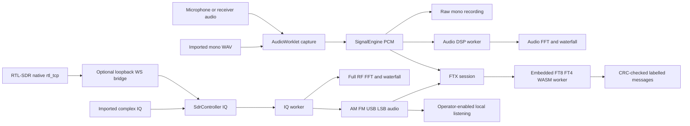

# RadioDesk architecture

RadioDesk is a modular TypeScript/C application distributed as one self-contained HTML file. Source boundaries separate radio control, device ownership, receive audio, DSP, wideband IQ, digital modems, operating sessions, transmit coordination, engineering, geometry, logging, storage and views. The distribution embeds code, styles, workers, the FT8/FT4 WASM binary, map data and required license notices. Offline tools need no application server or account; real RTL-SDR hardware uses an optional local native adapter.

## Source map

| Path | Responsibility |
| --- | --- |
| `src/main.ts` | Service ownership, eight workspace routes, station persistence, receive-source routing, transmit cancellation and app actions. |
| `src/core/` | Typed events, module metadata and queues for related mutations. |
| `src/radio/` | Receiver state, named FT-891 codec/driver, transaction serialization, authoritative CAT readbacks, simulator and scoped PTT access. |
| `src/devices/` | Browser capabilities, explicit discovery and selected Web Serial port ownership. |
| `src/audio/` | Capture/context/worklet lifecycle, mono PCM subscription, WAV playback/recording and RIFF codecs. |
| `src/dsp/` | Audio FFT/filter references and self-contained analysis worker. |
| `src/sdr/` | rtl_tcp header/command codec, fragmented U8 IQ, raw/stereo IQ import, complex RF FFT, streaming demodulation, speaker resampling, bounded client and compiled worker. |
| `bridge/` | Original Python standard-library loopback rtl_tcp-to-WebSocket adapter and framing/security tests. |
| `src/digital/` | Morse/ITA2 practice, controlled WAV decoder worker and the FT8/FT4 worker/runtime/API. |
| `src/operating/` | PCM resampling, UTC-slot collection, modem session state, labelled decoded messages and explicit waveform preparation. |
| `src/transmit/` | Volatile operator arm, bounded hold/scheduled PTT, watchdog/cancellation and confirmed RX state. |
| `wasm/` | FT8/FT4 C adapter, checked-in compiled binary, source/binary manifest and linked runtime notices. |
| `vendor/ft8_lib/` | Pinned upstream MIT modem and BSD KISS FFT source, licenses and independent fixture provenance. |
| `src/engineering/` | Pure complex/RF, matching, filter, feedline, antenna and unit calculations. |
| `src/propagation/` | Maidenhead, spherical paths, approximate solar geometry and embedded public-domain land polygons. |
| `src/logging/` | Contact validation, stable identity and ADIF interchange. |
| `src/storage/` | IndexedDB with localStorage/temporary-memory fallback. |
| `src/ui/` | Escaped HTML views, canvas displays, bindings/cleanup, selected audio output, operator controls and application export. |
| `build/` | Three worker bundles, WASM/data embedding, final HTML build, local launcher and artifact verification. |
| `tests/` | Pure references, compiled-worker execution, modem/recorded PCM compatibility, controller and lifecycle fixtures. |

Mathematical/protocol functions remain usable without a document or attached hardware. Views present service state; they do not become the radio truth. Numerical APIs use explicit Hz/ohms/meters/henries/farads. QSO dates and modem slots are UTC. Spectrum timestamps are monotonic; AudioWorklet receiver PCM maps sample positions to UTC through a context-clock anchor, while SDR PCM UTC is arrival based. Physical receiver/driver/ADC latency is not calibrated. dBFS is relative to digital full scale, without RF power calibration.

## Radio ownership and transmit scopes

`RadioController` publishes copies of receiver state: frequency, mode, connection/driver identity, CAT verification and observed PTT. `verified` means a successful protocol identity/state readback; physical testing is a separate claim. The selected serial transport owns its reader/writer locks. FT-891 identity is checked before settings/PTT are enabled. Transactions serialize complete setter/readback operations. A timeout closes the session so a late answer cannot satisfy a later request.

Receive transactions allow state queries and frequency/mode setters. They cannot key transmit. `TransmitController` obtains opaque, connection-bound scopes only after explicit operator arming and fresh confirmed RX. The FT-891 verifies the pinned frequency/mode/TX state again immediately before keying. Scope validity is checked at the actual serialized write; revocation defeats queued key requests. Emergency RX invalidates scopes, prioritizes a bounded `TX0;` request and requires subsequent receive readback. Failed release is reported as RX unconfirmed.

Transmit state is volatile and is never restored from storage. Manual PTT is a bounded hold. A prepared digital send is scheduled once with CAT lead/audio/tail boundaries; no automatic replies/repeats or missed-slot catch-up occur. Any workspace navigation stops output and disarms; pending audio preparation is checked against its originating workspace revision. Hidden-page/blur/pagehide, receiver changes, cancellation, missed deadlines and significant UTC/monotonic disagreement also stop applicable sends. An independent physical radio timeout/interlock is still required because a browser cannot guarantee shutdown after failure. See [transmit.md](transmit.md) and [hardware.md](hardware.md).

## Receive audio and IQ pipelines

`SignalEngine` owns mono capture/playback/recording and publishes both measurements and received PCM. Source generations prevent obsolete async starts. PCM is borrowed during synchronous subscribers; retain a copy if needed. Transferable buffers and bounded processing queues prevent unlimited audio work. Raw recording copies before gain/filtering; analysis uses the actual context sample rate. Microphone audio cannot reveal a panoramic RF band.

`SdrController` owns a separately named wideband IQ source. The rtl_tcp parser validates the fragmented 12-byte header and preserves I/Q alignment through odd chunks. Frequency/rate/gain commands are real packed protocol frames, but have no setting acknowledgements. The RF axis is therefore requested metadata, not an authoritative hardware readback. Offline metadata is explicitly distinct. Its worker maintains a bounded FFT ring, mixes/filters the selected channel, decimates and demodulates. Audio remains available to subscribers when speakers are muted; speaker playback resamples to the actual output rate.

Dropped samples and configuration revisions are exposed. Source/channel changes and drops invalidate digital windows; stale worker revisions are ignored and filters reset before recovery. This detects local loss but cannot detect every native USB/server sample loss. The Python bridge is loopback-only, token/exact-Origin guarded, has a fixed local upstream and permits receive-control opcodes only. See [sdr.md](sdr.md).

## Modem sessions and selected output

`FtxSession` owns FT8/FT4 receive/prepare state, resampling and a bounded slot collector. The operator selects receiver PCM or SDR demodulation. AudioWorklet receiver timestamps follow `currentFrame` sample positions anchored to UTC; SDR demodulated audio uses arrival-based UTC. Samples are assembled into contiguous slots, with incomplete/busy/discontinuous windows skipped. This mapping does not calibrate physical receiver/driver/ADC or SDR transport latency. The persistent modem worker executes actual upstream message packing, CRC/LDPC, waveform synthesis and receive search, and retains a bounded callsign hash cache.

A decode is produced by PCM input and valid upstream checks, not a generated message. Results identify live/imported/loopback sources. Sync score is not SNR; unresolved hashes remain placeholders. Reply composition changes a draft only. Encoding produces an active waveform plus a separately padded full-slot WAV; only the active buffer is scheduled at its protocol start delay. Encoding/import/decoding never key a radio.

Scheduled output requires a prepared packet, deliberate arm, fresh DATA-USB readback for real FT-891 sending, selected/confirmed radio audio route and enough bounded transmit duration. Output preparation precedes scheduling. Stop is idempotent; cancellation prevents a deferred audio start from resurrecting playback. Simulator output does not produce physical audio/RF. See [ftx.md](ftx.md) for protocol scope/independent receive recordings and [transmit.md](transmit.md) for release behavior.

## Local data and export

`LocalDatabase` stores station/contact data per browser origin, with visible IndexedDB/localStorage/memory mode. It does not synchronize across origins, files or machines. `MutationQueue` serializes related writes in one page. Web Locks, when available, coordinate cross-tab writes and reload persisted logs first. Without them, separate-tab concurrent mutations are not guaranteed safe.

Contacts retain stable ids, UTC, modes, reports, optional details and Hz frequencies. BAND-only imports retain `frequency: null`; an exact frequency is never invented. Contact identity supports deduplication. Active/deleted contacts persist together for recovery. ADIF provides interchange; JSON preserves the local data model and international metadata.

`portableHtml(document)` clones the application, removes live workspace/dialog/toast data and exports code/styles, not the station database. User ADIF/JSON exports are separate. Importers validate structure/lengths/units and views escape untrusted content. Endpoint access tokens, receive audio and station data are not sent to telemetry or cloud storage.

## Extension contracts

`ModuleRegistry` stores explicit compile-time metadata with unique id/name/capabilities and optional lifecycle hooks. Registration does not create routes, load plugins or invoke hooks. UI/service wiring is deliberate in `main.ts`; this is a source extension boundary, not a downloadable plugin sandbox. `EventBus` shares typed payloads and returns unsubscribe functions. Workspace cleanup removes view subscribers without stopping independent receiver services; transmit cancellation remains a separate navigation/lifecycle responsibility.

New calculations need validated pure functions, independent references and clear model limits. Radio drivers need named protocols and separate permission, identity, readback and physical evidence. Modems need actual PCM, compatible source licensing, independent received recordings/reference vectors and bounded work. Required WASM/data/workers must be included in the distribution, with license and memory effects documented.

## Packaging and verification

`build/build.mjs` bundles three imported worker entrypoints: controlled CW/RTTY WAV decoding, wideband IQ processing and FT8/FT4 modem execution. The FTX worker embeds `wasm/ftx.wasm` as base64. The main IIFE receives worker source constants, along with the existing self-contained audio DSP worker/capture worklet and static Natural Earth data. At runtime Blob URLs are local; no worker or WASM URL is fetched.

The final HTML contains one inline stylesheet/script, an empty app root and complete application/ft8_lib/KISS FFT/Emscripten/musl/math notices. `build/verify.mjs` parses the actual bundled JavaScript, checks eight nav/render cases, compares each compiled worker source, validates and hashes the embedded WASM, verifies notices, and rejects external runtime assets or embedded fixture recordings. Parsing never executes device/transmit code.

`npm run check` performs strict TypeScript, all Node tests (including the Python bridge runner), build and artifact verification. CI installs Node 24 and Python 3.13 and uploads the verified HTML. Ordinary builds use the checked-in modem binary; rebuilding it uses pinned Emscripten and updates its source/binary manifest. Browser/permission/audio/physical checks remain separate from these automated source/artifact gates.

`npm run dev` binds `127.0.0.1:4173` and rebuilds the same artifact on requests. `PORT` chooses another local port; configure the bridge's exact allowed Origin accordingly. This is local preview infrastructure, not a runtime cloud backend.
